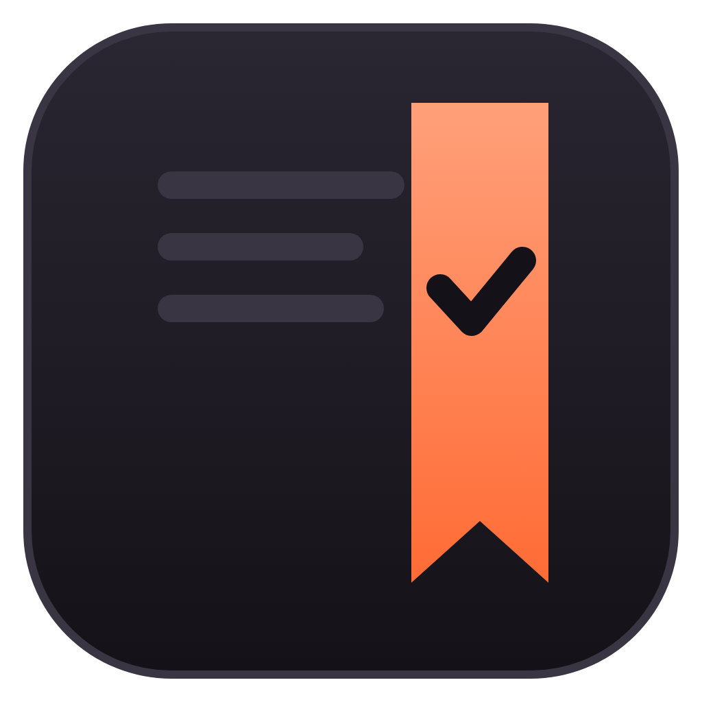
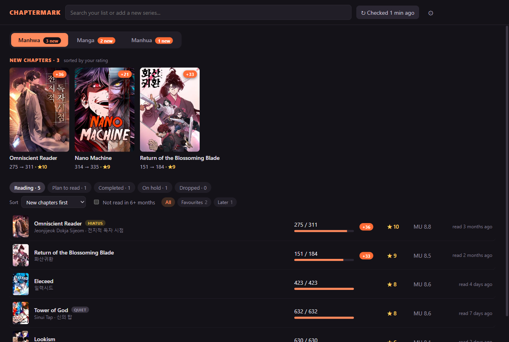
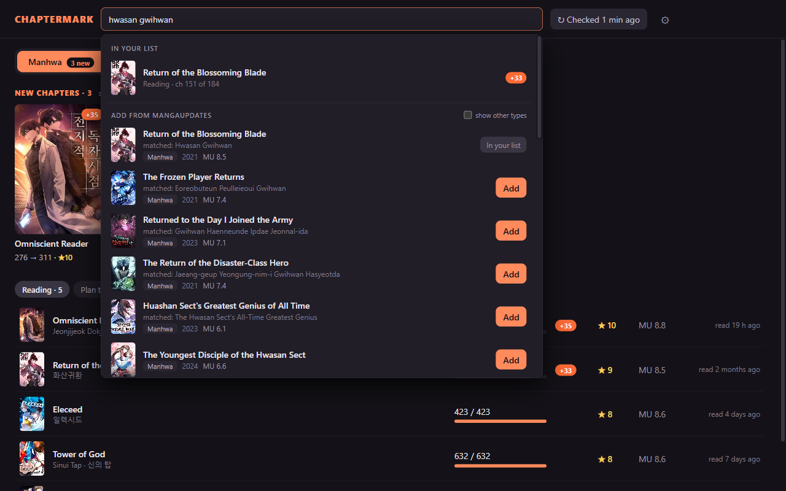
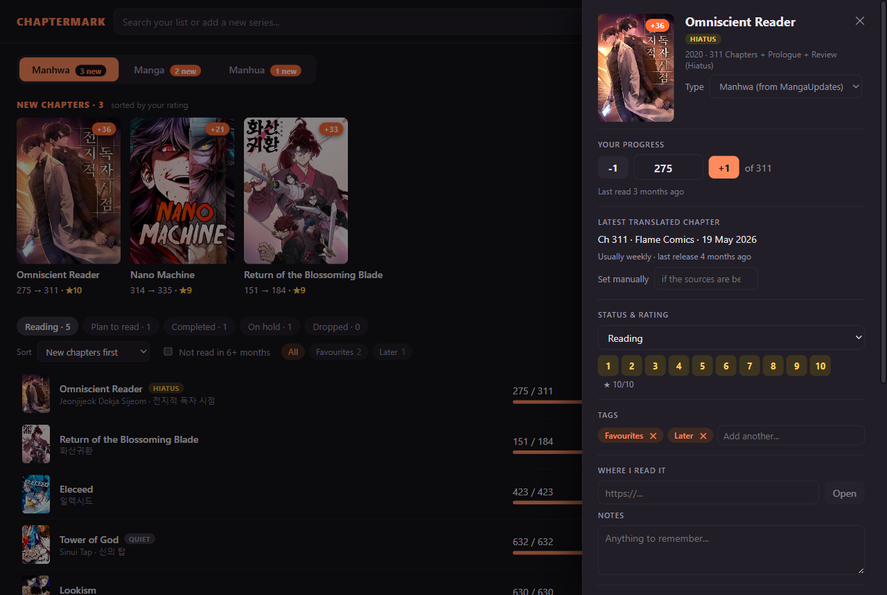

<div align="center">



# ChapterMark

**Never forget your last read chapter again.**

A portable Windows app that remembers the last chapter you read of every manga, manhwa and manhua,<br>
no matter which site you read it on, and shows you when new chapters have been translated.

[](https://github.com/jm5579/chaptermark/releases/latest)
[](https://github.com/jm5579/chaptermark/actions/workflows/ci.yml)
[](#getting-started)
[-3a3542?style=flat-square)](#where-your-data-lives)
[](LICENSE)

[](https://go.dev)
[](https://wails.io)
[](https://react.dev)
[](https://sqlite.org)

### [Download for Windows](https://github.com/jm5579/chaptermark/releases/latest)

<br>



</div>

<br>

## Features

<table>
  <tr>
    <td width="34%"><b>Remembers your place</b></td>
    <td>Last chapter read, your rating, status and notes for every series, all in one place.</td>
  </tr>
  <tr>
    <td><b>New chapters at a glance</b></td>
    <td>Finds the highest translated chapter on MangaUpdates and which group released it. Series with unread chapters show up first, sorted by your rating.</td>
  </tr>
  <tr>
    <td><b>Search by any name</b></td>
    <td>English, romanized (<i>Jeonjijeok Dokja Sijeom</i>) or native script (<i>전지적 독자 시점</i>). They all find the same series.</td>
  </tr>
  <tr>
    <td><b>Manhwa, Manga, Manhua</b></td>
    <td>Switch between the three types. Each one shows how many of its series have new chapters.</td>
  </tr>
  <tr>
    <td><b>Your rating and public ratings</b></td>
    <td>Rate series from 1 to 10 and see the MangaUpdates and AniList scores next to yours.</td>
  </tr>
  <tr>
    <td><b>Portable</b></td>
    <td>One <code>.exe</code>. No installer, no account, nothing written outside its folder. Your list lives in a <code>data</code> folder next to the exe, so you can copy the folder to another PC and carry on.</td>
  </tr>
  <tr>
    <td><b>Sort and filter</b></td>
    <td>Sort by your rating, title, last read, new chapters and more, or show only the series you haven't read in 6 months.</td>
  </tr>
  <tr>
    <td><b>Release rhythm</b></td>
    <td>See how often a series gets new chapters and when the last one came out. Badges mark series that are on hiatus, finished, or have gone quiet.</td>
  </tr>
  <tr>
    <td><b>Your own lists</b></td>
    <td>Tag series with your own lists, like Favourites or Binge later, and filter by them.</td>
  </tr>
  <tr>
    <td><b>18+ filter</b></td>
    <td>Hentai, smut and other adult titles are hidden from search and from your list unless you allow them in Settings. Ecchi and mature titles still show.</td>
  </tr>
  <tr>
    <td><b>Backups</b></td>
    <td>A backup is saved every day you open the app (the last 10 are kept). You can also export your list to a single file and import it again. Your list opens offline.</td>
  </tr>
</table>

## Screenshots

<table>
  <tr>
    <td width="50%"></td>
    <td width="50%"></td>
  </tr>
  <tr>
    <td align="center"><b>Search by any name</b><br><sub>Your list first, then MangaUpdates, with the alternate name that matched</sub></td>
    <td align="center"><b>Update your progress</b><br><sub>+1 per chapter, rating, status, notes and where you read it</sub></td>
  </tr>
</table>

## Getting started

1. Download **`ChapterMark-vX.Y.Z-windows.zip`** from [Releases](https://github.com/jm5579/chaptermark/releases/latest).
2. Extract the `ChapterMark` folder anywhere you can write to, such as your Desktop, Documents or a USB stick.
3. Double-click **`ChapterMark.exe`**. There is nothing to install.

> [!NOTE]
> The first time you run a downloaded copy, Windows may show **"Windows protected your PC"** because the exe isn't code-signed. Click **More info**, then **Run anyway**.

Requires Windows 10 or 11. It uses the Microsoft Edge WebView2 runtime that comes with Windows.

## Using it

- **Add a series.** Type any of its names in the search box. Results from MangaUpdates appear under *Add from MangaUpdates*. Click **Add**, then set the last chapter you read and your rating.
- **Pick the type.** The **Manhwa / Manga / Manhua** switch shows one type at a time.
- **See what's new.** The *New chapters* row lists the series you're reading (or have on hold) that have unread chapters, highest rated first.
- **Update your progress.** Click a series and press **+1**, or type the chapter number. You can also set the status, your rating, notes and a link to where you read it.
- **Sort and filter the list.** Use the bar above the list to change the order, show only series you haven't read in 6+ months, or pick one of your tags. Your choices are remembered.
- **Tag series.** In a series panel, type a tag such as *Favourites* and press Enter. Rename or delete tags in Settings.
- **Check the release rhythm.** The series panel shows how often new chapters usually come out and when the last one was released. **Hiatus**, **Finished** and **Quiet** badges appear next to a title when they apply.
- **Show or hide 18+ titles.** They are hidden by default. A title counts as 18+ when MangaUpdates tags it Hentai, Smut, Adult, Lolicon or Shotacon, MangaDex rates it erotica or pornographic, or AniList marks it adult. Tick **Show 18+ titles** in Settings to see them in search and in your list.
- **Stay up to date.** ChapterMark checks for new chapters when it starts and again every 6 hours while it's open. You can change the interval in Settings or check right away with the **Checked** button at the top. If the sources are behind, you can set the latest chapter yourself in the series panel.

## Where your data lives

```
ChapterMark/
  ChapterMark.exe
  data/
    library.db    your list (SQLite)
    covers/       cover images, saved so the app works offline
    backups/      one copy per day you open the app (last 10 kept)
    webview/      the built-in browser's cache
```

> [!TIP]
> To move to another PC, copy the whole `ChapterMark` folder. **Settings > Export list** saves your list to a single file you can keep anywhere, and **Import list** merges it back or restores it.

## Data sources

ChapterMark uses the free public APIs of [MangaUpdates](https://api.mangaupdates.com), [MangaDex](https://api.mangadex.org/docs/) and [AniList](https://docs.anilist.co). No accounts or API keys are needed. It identifies itself with a `ChapterMark/1.0` User-Agent and spaces out its requests (about one per second to MangaUpdates).

<sub>Cover art and titles belong to their creators and publishers. ChapterMark is a personal tracker and is not affiliated with MangaUpdates, MangaDex or AniList.</sub>

## Building from source

<details>
<summary><b>Build, test and release</b></summary>

<br>

You need [Go](https://go.dev/dl/) 1.26 or newer, [Node.js](https://nodejs.org) 20 or newer, and the Wails CLI:

```bash
go install github.com/wailsapp/wails/v2/cmd/wails@v2.17.0
```

Build the exe. It is written to `build/bin/ChapterMark.exe`, with its data in `build/bin/data`.

```bash
wails build
```

Run it in development mode with hot reload:

```bash
wails dev
```

Run the tests:

```bash
go test ./...
```

```bash
cd frontend && npm test
```

To publish a release, push a version tag. GitHub Actions builds the exe and attaches `ChapterMark-<tag>-windows.zip` to a new release.

```bash
git tag v2.1.0 && git push origin v2.1.0
```

</details>

## History

- **v2, ChapterMark:** this portable Windows app, built with Go, Wails and React. It replaces the original tracker.
- **v1.0.0, the original Python manga tracker:** the code is kept in the repository history. Run `git checkout v1.0.0` to see it.

## License

MIT. See [LICENSE](LICENSE).
